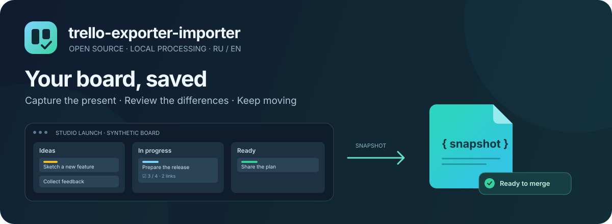
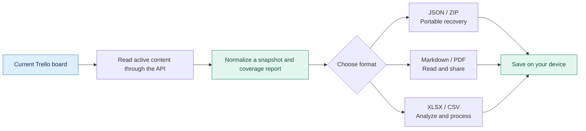
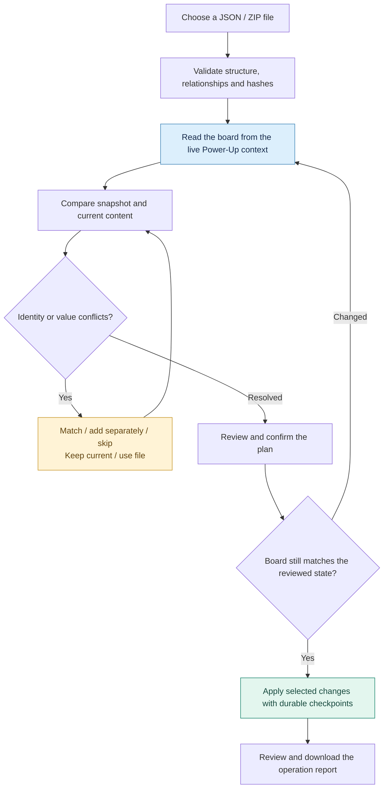

<p align="center">
  
</p>

<p align="center">
  <a href="https://github.com/selutin99/trello-exporter-importer/actions/workflows/ci.yml"></a>
  <a href="LICENSE"></a>
  
  
</p>

# trello-exporter-importer

An open-source Trello Power-Up for exporting active board content in six formats
and importing saved JSON/ZIP content into the board you have open. Save a portable
backup, create a readable report, or review and merge saved content into another
existing board.

## Contents

- [Features](#features)
- [Export flow](#export-flow)
- [Import and conflict resolution](#import-and-conflict-resolution)
- [Formats](#formats)
- [Snapshot contract](#snapshot-contract)
- [Recovery and limitations](#recovery-and-limitations)
- [Privacy and permissions](#privacy-and-permissions)
- [Compatibility](#compatibility)
- [Contributing and license](#contributing-and-license)
- [Development](#development)

## Features

- Capture active lists, active cards, descriptions, labels, dates, checklists,
  comments, and attachment metadata
- Bundle available original Trello uploads in a ZIP with SHA-256 integrity checks
- Restore supported content into the **currently open board**, with a comparison
  before any writes and explicit choices for conflicting values
- Reuse matching identities and verified mappings from this browser's previous
  merge, keeping repeated imports from blindly duplicating objects
- Generate documents and spreadsheets from the same captured state
- Process files locally, switch between English and Russian, and use light or
  dark themes

Snapshots describe current content over a capture interval. Custom fields,
archived lists and cards, activity history, scheduled backups, and continuous
synchronization are outside the MVP scope.

## Export flow

1. Open **trello-exporter-importer** from the board's Power-Ups
2. Update board information and choose ZIP, JSON, Markdown, PDF, XLSX, or CSV
3. For ZIP, select **Connect file access** and review Trello's one-day read-only
   account grant for original uploads
4. Select **Export**, then review the file's completeness and any missing content
5. Download the prepared file; keep JSON or ZIP for a later import

Each format card has one format marker and a description. Export and import share
the same footer layout: a centered action, a divider, a full-width local-processing
notice, a separate duration notice, and expandable technical details. Import's
technical details also describe permissions and fidelity limits.

Boards without active cards in active lists cannot be exported. If cards are added
to an empty board, update the board information before exporting. A fresh capture
that finds no active cards also stops without preparing a download.



Capture is best-effort, not a database transaction. Avoid editing the board while
exporting. Missing sections and file downloads produce explicit warnings; an
apparently successful download does not establish a complete backup.

## Import and conflict resolution

Open the destination board first: it can be the original board or another board
where the Power-Up is enabled. Choose **Import**, select a project JSON/ZIP,
review the destination and merge plan, resolve conflicts, confirm the reviewed
changes, and select **Import**. Import does not create a board. The footer describes
local processing and includes technical details about limits, permissions, and
content that cannot be imported exactly.

<p align="center">
  
</p>



| Situation                                 | Behavior                                                                             |
| ----------------------------------------- | ------------------------------------------------------------------------------------ |
| Same ID and matching supported values     | Reuse the existing object; no write                                                  |
| Missing object with no matching candidate | Add it under its mapped parent                                                       |
| Same name with different IDs              | Ask which current object to match, add separately, or skip the snapshot object       |
| Different supported values                | Require **Keep current** or **Use file** per field; bulk value choices are available |
| Changed comment or attachment             | Keep the current object or add a separate copy from the snapshot                     |
| Content present only on the current board | Preserve it                                                                          |
| Board changes after review                | Stop and require a fresh comparison                                                  |

This is a two-way comparison of saved and current data. A snapshot does not
contain a common ancestor for an automatic three-way merge. Names are candidates,
not proof of identity. Selecting a different object can reveal further field
conflicts; all must be resolved before applying.

Existing positions are preserved. New lists, cards, checklists, and items
are appended in snapshot order. A card's destination list can be an explicit
conflict. Board name, privacy, memberships, and permissions remain unchanged;
board description is a selectable content difference. Import never deletes or
automatically archives current content.

## Formats

| Format   | Intended use                              | Original attachment bytes | Import |
| -------- | ----------------------------------------- | ------------------------- | ------ |
| JSON     | Portable normalized snapshot              | No                        | Yes    |
| ZIP      | Snapshot, manifest, and available uploads | Yes                       | Yes    |
| Markdown | One readable UTF-8 document               | No                        | No     |
| PDF      | A4 report grouped by list and card        | No                        | No     |
| XLSX     | Related worksheets with typed values      | No                        | No     |
| CSV      | Flat table, one row per card              | No                        | No     |

Trello's native JSON exports, arbitrary ZIP files, and diagnostic reports are not
accepted as project snapshots. Import accepts only this project's JSON/ZIP files.

Markdown and PDF include literal board content, checklists, comments, and
available attachment links. PDF embeds bundled fonts; unsupported characters are
shown as `[U+HEX]` with a notice. Neither format fetches external images or embeds
attachment files.

XLSX separates board collections into linked sheets, freezes headers, and keeps
source strings as text rather than formulas. Long values use ordered rows in a
`TextChunks` sheet so the original text can be reconstructed without truncation.
CSV uses UTF-8 with a BOM, comma delimiters, CRLF records, quoted multiline cells,
and JSON for nested collections. Dangerous spreadsheet prefixes receive a leading
apostrophe. Empty lists and board-level metadata do not become CSV rows; use JSON
or XLSX when those are needed.

## Snapshot contract

The current contract is `trello-exporter.snapshot`, version `0.1.0`, encoded as
UTF-8 JSON. It contains board metadata, normalized collections with source-ID
relationships, capture information, per-section `coverage`, and `issues`. Dates
use UTC; unknown values are explicit. Collection arrays remain present when empty.
Sibling `order` values preserve relative order instead of Trello's numeric `pos`.

New snapshots retain empty `customFields` and `customFieldValues` arrays with
`excluded` coverage. These collections remain in the executable schema so older
JSON/ZIP files can still be validated. Import skips their field definitions,
options, and values and reports the omissions; existing board fields are preserved.

New files identify their producer as `trello-exporter-importer`. Import also accepts
the former `trello-exporter` producer name. The serialized identifiers
`trello-exporter.snapshot`, `trello-exporter.archive`, and
`trello-exporter.restore-report` intentionally retain their original values and
version: the rebrand does not rename the file formats. Exported filenames, interface
labels, PDF authorship, and repository links use the new name.

ZIP adds an integrity inventory and available original uploads:

```text
trello-exporter-importer-<date>.zip
├── manifest.json
├── snapshot.json
└── attachments/
    └── <attachment-id>/
        └── content
```

The `trello-exporter.archive` manifest lists `snapshot.json` and every attachment
with its relative path, uncompressed size, and SHA-256. Duplicate or unsafe paths,
unlisted or missing entries, hash/size mismatches, unsupported versions, and
broken relationships fail validation. SHA-256 detects corruption; it is not a
digital signature.

Standalone JSON has no embedded files or local-file references. ZIP file coverage
reports which uploads were actually downloaded. Unavailable upload bytes are
omitted with `FILE_UNAVAILABLE`; review the coverage report before relying on a ZIP
as a backup. Downloads use the original upload `fileName` when available, preserving
the download path after its display name changes, including in exported attachment
links. An interrupted
download body is also reported as `FILE_UNAVAILABLE`; the remaining ZIP stays
importable. Cancellation stops packaging instead of returning a completed file.
External links are retained as safe metadata and are never fetched.
Import is bounded to 300 MiB total input
and expanded content, 16 MiB per JSON entry, and 10,000 entries; ZIP expansion is
also bounded to reject excessive compression ratios. Export allows 250 MiB of
original upload bytes.

The executable schemas and checks live in [src/import/](src/import/). Synthetic
captures and file bytes live only in [test/helpers/](test/helpers/).

## Recovery and limitations

Before a write, a durable local journal records the pending operation. Confirmed
results retain ID mappings, selected resolutions, and operation hashes. The
report contains the destination link, status, skipped operations, and limitations;
it does not contain attachment bytes, card bodies, or tokens.

After a known failure or cancellation, select the same export file in the same
browser on the same board, choose **Compare again**, review the updated plan, and
continue the last operation. Already confirmed creates are reused. A stale or
incompatible continuation is blocked. Legacy journals from the former new-board
restoration flow cannot select a destination or resume it.

The same-browser journal storage key remains unchanged during the rebrand, so
existing mappings, pending writes, and continuation checkpoints are not discarded.
The GitHub Pages hostname and Power-Up identity must remain the same during the
URL-path migration; clearing local storage loses the recovery history.

A lost write response has status `unknown`: the server may have applied the
request. Automatic repetition is blocked. Inspect the board and downloaded report
before reconciling the pending change. A new operation stays blocked while that
uncertain journal remains, even after switching boards. Clearing this site's local
recovery storage after manual reconciliation also loses its saved mappings.
Applied changes remain when an operation stops. There is no automatic rollback.

Trello has no atomic compare-and-write transaction here. The app refreshes the
whole comparison before applying and checks selected old field values before
updates, but concurrent edits can still race with API requests. Avoid editing
during import.

Added objects receive new Trello IDs. Original authors and timestamps cannot be
recreated: imported comments become attributed text copies by the importing user,
with long comments split into bounded parts. Member assignments, card covers,
checklist assignees, activity history, permissions, and unsupported Power-Up data
are not reconstructed. Links in user text are preserved and can still point to
the source board. JSON can recreate available source file links; ZIP is required
for available original bytes to be uploaded independently of the source.

## Privacy and permissions

The app uses the official Power-Up SDK and Trello REST API. Processing happens on
your device, without a project-operated processing server. GitHub Pages serves
static application assets. Downloaded exports are unencrypted and may contain
private board data; store and share them accordingly.

OAuth read/write grants apply within the authorized Workspace. The grant is
broader than this app's own current-board checks. Review the actual consent screen
and use an isolated test Workspace during development. ZIP file access uses a
separate one-day Trello Auth read grant across the account, while the reader
remains restricted to the open board. The live SDK context
selects the import destination; snapshot IDs and downloaded operation reports
cannot choose another board. Parent ownership and active state are rechecked
before mutations. API origins are fixed in [src/config/services.ts](src/config/services.ts).

A same-browser recovery journal is stored locally. Interface preferences and
OAuth storage behavior are described in the localized `privacy.html` notice.
Never publish real exports, attachments, tokens, or recovery journals in an issue
or commit.

## Compatibility

The intended clients are Trello in Chrome and Trello Desktop on macOS, with
Russian and English interfaces. For Trello Desktop, authorize the board in Chrome,
then return to Desktop and reopen the Power-Up.

## Contributing and license

See [CONTRIBUTING.md](CONTRIBUTING.md) and the repository's
[issue templates](https://github.com/selutin99/trello-exporter-importer/issues/new/choose).
Use synthetic examples and include the relevant coverage or operation outcome.

[MIT](LICENSE), copyright 2026 Alexander Selyutin. This is an independent project
and is not affiliated with Atlassian or Trello.

## Development

Use Node.js 24, or a compatible runtime (`^20.19.0`, `^22.13.0`, or `>=24`).
The app is one strict TypeScript npm project built with Vite.

```sh
git clone https://github.com/selutin99/trello-exporter-importer.git
cd trello-exporter-importer
npm ci
npm run check
npm run dev
```

Open `http://127.0.0.1:4173/trello-exporter-importer/pages/export.html` for the local UI.
A standalone page validates local files; current-board comparison, export, and
writes require the registered Power-Up opened inside Trello. There is no bundled
demo mode and no automatic board access when a local preview opens.

### Project layout

```text
src/
├── api/          Scoped reads, transport, ownership checks
├── app/          Export/import UI and sessions
├── config/       Product identity and trusted service endpoints
├── core/         Operations, cancellation, and shared workflows
├── export/       Markdown, PDF, XLSX, and CSV rendering
├── i18n/         English and Russian resources
├── import/       Snapshot and archive validation
├── restore/      Merge planning, checkpoints, and guarded writes
├── snapshot/     Capture, normalization, and ZIP packaging
├── trello/       Official SDK integration and OAuth callbacks
├── pages/        HTML entry points
├── styles/       CSS and shared themes
└── assets/       Product icons and bundled visual resources
test/             Source-mirrored tests and synthetic helpers
.github/          CI/CD, community templates, and README illustrations
```

Keep tests parallel to their source files. Public contracts use TSDoc with
`@param`, `@returns`, and meaningful `@throws` descriptions. Code, comments, and
repository text are in English; Russian product copy lives in locale resources.
Use named enums for stable protocol values. Generated output and private runtime
data stay out of Git.

The restore UI controller owns DOM events, while `RestoreSession` owns local
input, comparison state, authorization waits, and cancellation. Merge planning
is pure: it compares validated snapshots and explicit choices without an SDK or
HTTP dependency. The engine revalidates the reviewed plan before execution, and
`restore/merge/review.ts` verifies the fresh comparison and the remaining action
hashes for continuation. `RestoreCheckpoint` records pending and confirmed writes
in the local journal; journal creation and validation stay in `restore/journal.ts`.
Execution uses independent `RestoreWriter` and `RestoreSteps` contracts. The HTTP
and checkpoint classes implement these contracts without defining the domain's
interfaces; scoped I/O contracts live in `restore/writer.ts`.
`RestoreApi` coordinates fixed API paths with `RestoreScope` ownership checks
and pure payload guards in `restore/payloads.ts`. Unsupported optional writes
are reported as omissions. Legacy custom fields are excluded before planning and
never dispatch field API requests. Format renderers consume the
normalized snapshot independently of the SDK and restoration workflow.

`snapshot/coverage.ts` finalizes section counts and completeness independently of
API capture and ZIP packaging. Capture and input validation share named snapshot
sections and the same collection inventory. `core/stream.ts` owns cancellable
byte-stream iteration and reader cleanup for local scans and attachment downloads.
Transport converts failed download bodies into explicit file omissions during ZIP
packaging. Cancellation of an OAuth token wait never dispatches a late request;
dispatched writes retain their confirmed or unknown outcome without retries.

### Commands and checks

| Command                 | Purpose                                                        |
| ----------------------- | -------------------------------------------------------------- |
| `npm run dev`           | Local source server on `127.0.0.1:4173`                        |
| `npm run check`         | Types, typed/CSS lint, smells, formatting, coverage, and build |
| `npm test`              | Run offline tests                                              |
| `npm run test:watch`    | Watch tests during implementation                              |
| `npm run test:coverage` | Generate ignored HTML, LCOV, and JSON coverage reports         |
| `npm run format`        | Apply formatting                                               |
| `npm run lint:fix`      | Apply supported lint fixes                                     |
| `npm run build`         | Create ignored `dist/` output                                  |
| `npm run preview`       | Serve the build at `/trello-exporter-importer/export.html`     |

Coverage gates are 90% for statements, functions, and lines, and 85% for branches.
Synthetic HTTP/SDK tests cover ownership rejection, file integrity, conflicts,
repeat imports, cancellation, partial writes, uncertain outcomes, and recovery.
Live client acceptance and workload checks are tracked separately in
[GitHub Issues](https://github.com/selutin99/trello-exporter-importer/issues/4).

### Registering a test Power-Up

1. Host `dist/` over HTTPS and create an isolated test Workspace with an approved
   test board
2. Register a Power-Up with
   `connector.html?clientId=<PUBLIC_CLIENT_ID>&appKey=<PUBLIC_TRELLO_API_KEY>` under the
   deployed base URL; real references belong in runtime settings
3. Configure the official SDK's OAuth client and register the exact same-origin
   `authorize.html?clientId=<PUBLIC_CLIENT_ID>` callback URL
4. Create the Power-Up's Trello Auth API key for ZIP downloads and allow the deployed
   origin in its redirect origins. This public key is not the app secret or a user
   token. Never put a secret or token in the connector URL
5. Use the hosted `privacy.html` notice and this repository's Issues for support
6. Enable the Power-Up on the approved board, verify the Workspace and scopes on
   the consent screen, then test the read flow before authorizing write tests

The active board comes from the SDK. The optional legacy `board` query parameter
remains available for historical diagnostics. Production builds retain
`/prototype/*.html` aliases for existing registered callbacks; source files live
under `src/`. Do not change callback paths without updating the registration.
Live tests must stay on explicitly approved boards and must never enumerate
unrelated boards or touch their content, memberships, settings, or Power-Ups.

ZIP downloads use the official SDK's Trello Auth client with an explicit one-day
`read` grant. Trello grants this read access across the account; the reader still
checks the current SDK board and discovered card/upload ownership before each
file request. Board data and imports keep their OAuth 2.0 flow. The download
transport sends the classic key/token pair only in the `Authorization` header to
the fixed Trello API origin, omits cookies, and lets Fetch strip authorization on
cross-origin file redirects. External attachment URLs are never fetched. The
SDK manages both kinds of tokens, including its file-callback browser storage;
they never enter exports, journals, or application logs. The standalone return
page initializes the SDK for its file callback without opening board API access.
ZIP export waits for file consent; other formats do not require that grant.
If a stored file grant expires or is revoked, select **Reset file access**, then
**Connect file access** in a fresh click. Reset clears the SDK connection without
revoking the grant; account settings provide revocation.

### Delivery

CI runs quality gates and Gitleaks, uploading coverage and the checked site as
separate artifacts. Gitleaks scans push/PR commit ranges; manual CI dispatch scans
history. CI itself does not deploy.

A separate CD workflow publishes only the successful main-branch push CI run's
`power-up-site` artifact to [GitHub Pages](https://selutin99.github.io/trello-exporter-importer/).
It uses the triggering run ID and does not rebuild a newer checkout. Pull request
artifacts and coverage reports are never deployed. Set the repository's Pages
source to **GitHub Actions**. If the seven-day site artifact expires, rerun CI.
Only the deployment job receives Pages write permissions.

### Branding and deployment URLs

The repository, npm project, and Power-Up display name are
`trello-exporter-importer`. Production assets use the
`/trello-exporter-importer/` base path. The registered connector, icon, privacy,
support, and OAuth callback URLs must be updated with the hosted build when moving
from the former repository name. Preserve query parameters containing the public
client ID and keep the existing Power-Up and OAuth client rather than creating
replacement identities.

GitHub redirects repository links after a rename, but project-site URLs do not
receive that redirect. Register the exact new same-origin `authorize.html` URL,
including its public `clientId`, before switching the connector. Retain any needed
`/prototype/authorize.html` callback because compatibility pages are still built.
See [GitHub repository rename behavior](https://docs.github.com/en/repositories/creating-and-managing-repositories/renaming-a-repository)
and [Trello OAuth callback configuration](https://developer.atlassian.com/cloud/trello/guides/rest-api/oauth-2-client-configuration/).
